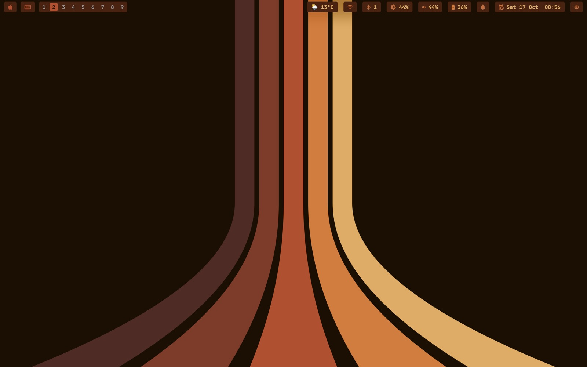
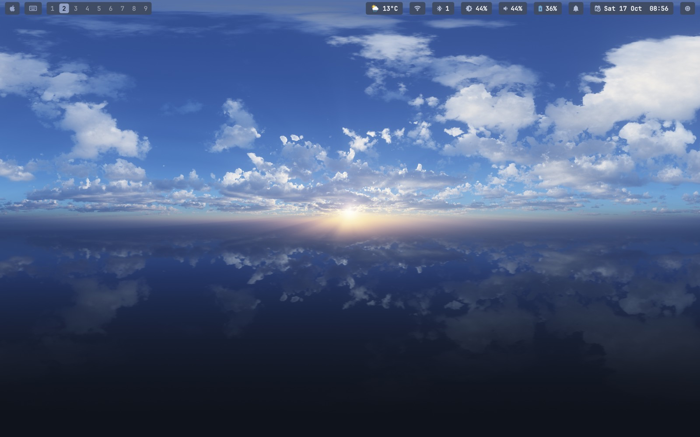
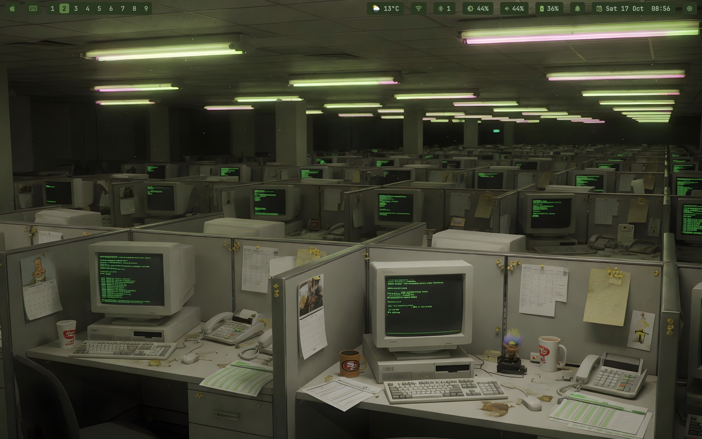
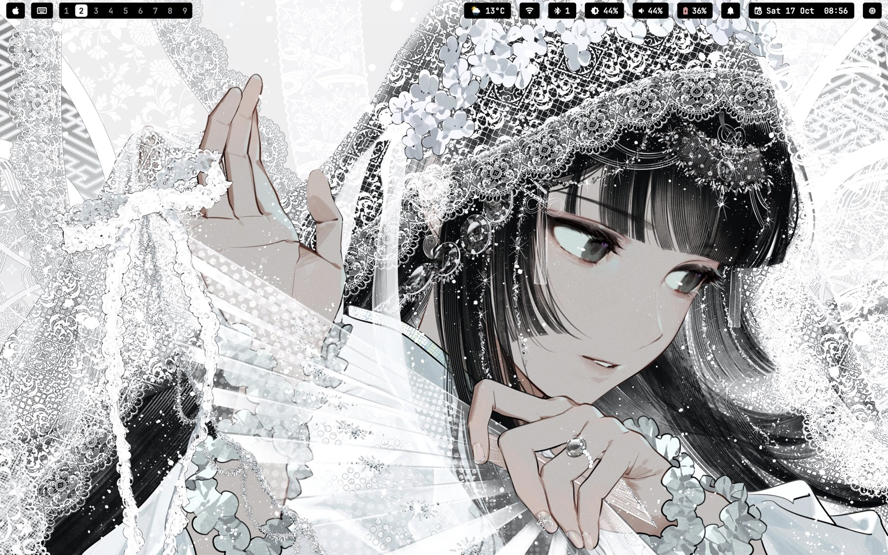
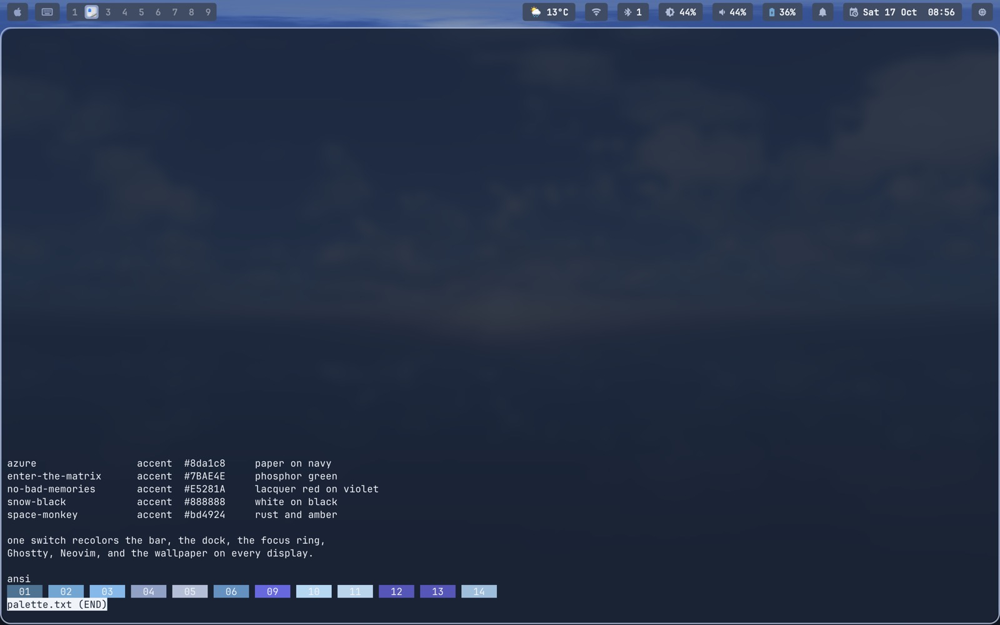
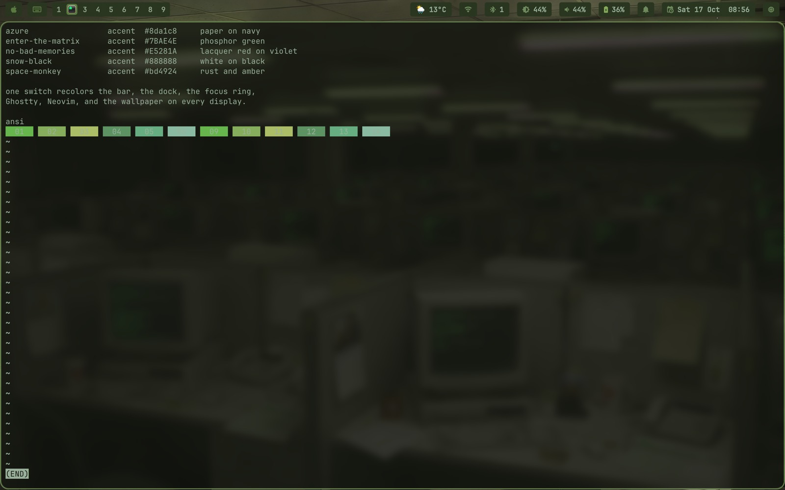
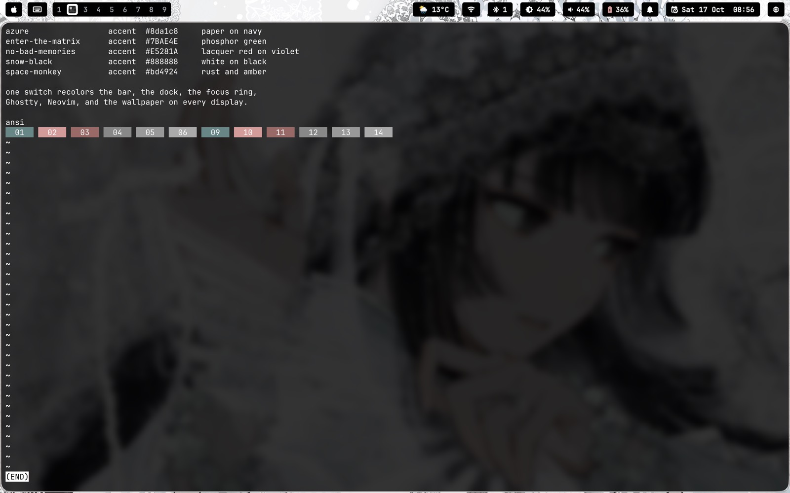
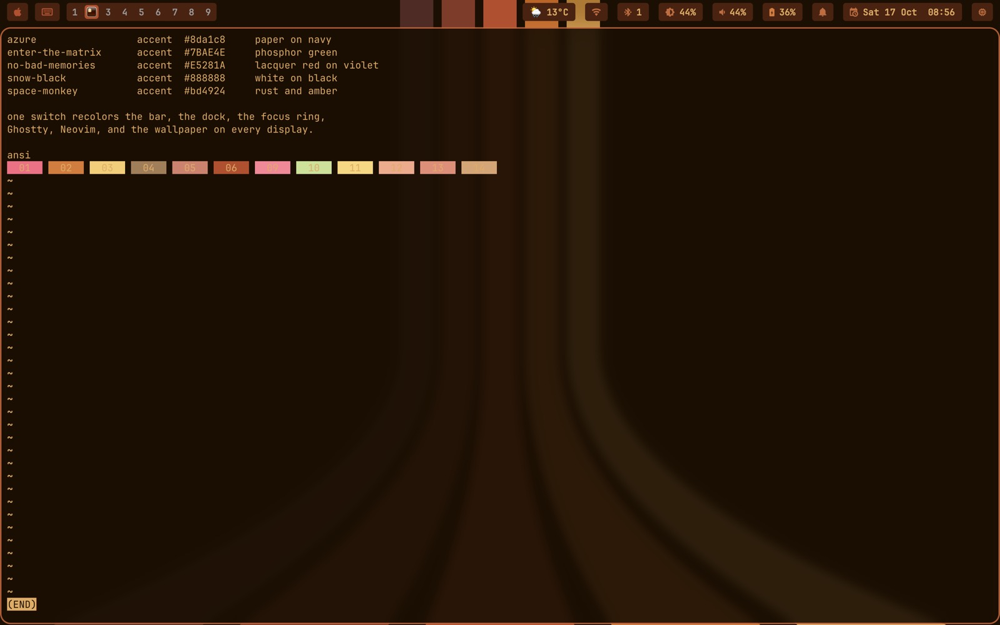
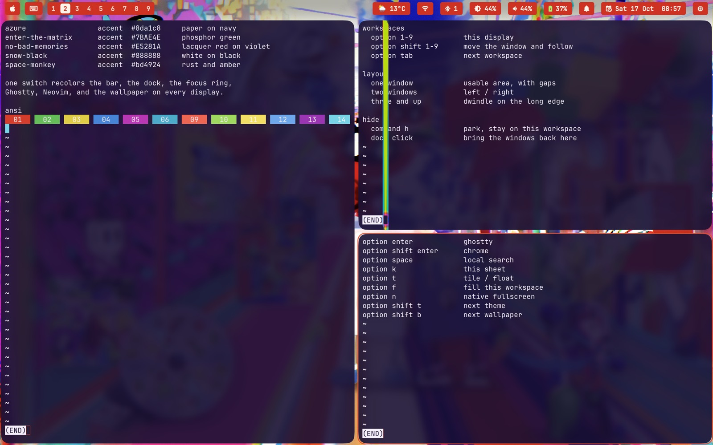
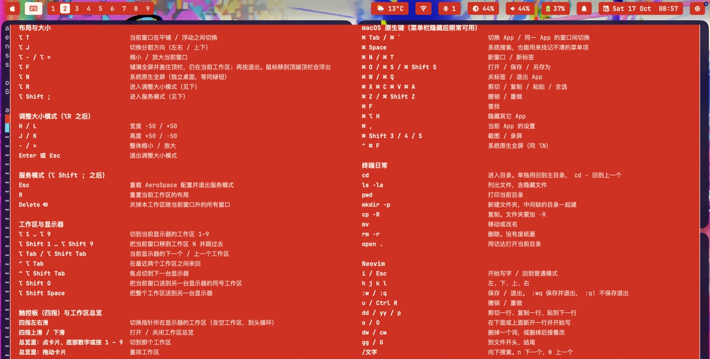

# omacosy

A personal tiling Mac: AeroSpace, a themed bar and dock, five palettes
that recolor the whole session, Super as Option so Command still means
macOS.

Forked from [paulsp94/omacosy](https://github.com/paulsp94/omacosy)
(omarchy-style rice for macOS). Daily-driven on an M1 MacBook Air,
macOS 26, SIP on.



Same tree is also published as
[omacosy-standalone](https://github.com/YikesYellowPharmakon/omacosy-standalone)
and [mac-theme](https://github.com/YikesYellowPharmakon/mac-theme).

**Known limit.** Sequoia's green-button hover tiling cannot be turned
off and does not match this rice's usable area. Use Option chords to
arrange. Leave the green button as the system fullscreen / Split View
hatch.

## What you get

- **Tiling that stays a Mac.** One window fills the usable area (gaps,
  not edge-to-edge). Two sit left/right. Three and up dwindle: a new
  window splits the focused pane along its longer edge.
- **Super is Option.** Copy, paste, tabs, `Cmd-Tab`, `Cmd-Space` stay
  Command. Caps Lock stays Caps Lock for the Chinese IME.
- **One theme switch.** `Option-Shift-T` (or the Apple menu → Theme)
  recolors the bar, dock, borders, Ghostty, Neovim, btop, and the
  wallpaper on every display. `Option-Shift-B` walks that theme's
  wallpapers. Each theme remembers the last accent and wallpaper.
- **Hide stays put.** `Cmd-H` parks the app's windows on a hidden
  workspace instead of handing focus to whatever you used last, so the
  desktop does not jump. Click the dock icon or `Cmd-Tab` to bring
  them back to the workspace you are on.
- **Bar, dock, overview, screensaver** are all themed. The native menu
  bar stays hidden; the native Dock stays buried. Hover the bottom
  edge for the capsule dock. Four-finger swipe for workspaces and
  overview.

Default apps (`config/apps.conf`): Ghostty, Google Chrome, NetEase
Cloud Music, ChatGPT.

Full chord list: [`docs/omacosy-键位设置.html`](docs/omacosy-键位设置.html)
(`Option-K` on the machine).

## Themes

Five palettes. One switch paints the bar pills, the dock icons
(including Ghostty's), the window ring, terminals, Neovim, and the
lock screen (same wallpaper as the desktop).

| Theme | Feel | Accent |
|---|---|---|
| **azure** | paper over navy | `#8da1c8` |
| **enter-the-matrix** | phosphor green, no leftover red/blue | `#7BAE4E` |
| **no-bad-memories** | lacquer red on violet; wallpaper is local, not in git | `#E5281A` |
| **snow-black** | white on black, gray ring | `#888888` |
| **space-monkey** | rust and amber | `#bd4924` |






The same four, with a staged terminal so the palette recolors the text.
Nothing on screen is a personal window. `no-bad-memories` is the daily
theme; its wallpaper is local and not in this repo. The tiling shot
below is that theme, with Ghostty left transparent the way it runs.






What a theme actually recolors:

- **Bar:** workspace chips (digit, or the sole app's icon), Apple
  menu, weather / wifi / bluetooth / brightness / volume / battery /
  clock / activity, every popup.
- **Dock:** app icons, including a per-theme Ghostty icon written to
  `~/.local/state/omacosy/ghostty-icon.png`.
- **Windows:** focus ring (`omacosy-borders`), AeroSpace gaps.
- **Terminal:** Ghostty palette, cursor shaders (idle work skipped so
  typing does not stutter), Neovim cursor pulse.
- **Lock screen:** same wallpaper as the desktop.

`no-bad-memories` samples its palette from the MV / album art. That
wallpaper lives under `themes/no-bad-memories/backgrounds/` and is
gitignored.

## Layout and workspaces



Each display owns nine workspaces: main 1–9, external 11–19. Same last
digit is the same slot. `Option-N` switches this display's slot N;
`Option-Shift-N` moves the window and follows it. Unplug the external
display and occupied 11–19 fold into free 1–9 slots; plug it back and
they go home.

Workspace chips on the bar count **windows**, not apps: one visible
window shows that app's icon; more than one, or none (minimized /
hidden / parked), shows the digit.

Fullscreen:

- `Option-F` — AeroSpace fill on this workspace. The bar hides; hover
  the top edge to get it back.
- `Option-N` — native macOS fullscreen (its own Space), same as the
  green button.

Clicking a hidden app in the dock while the current workspace is
native-fullscreen opens that app alone on an empty workspace and
switches there, instead of shoving it into the fullscreen Space.

## Bar, dock, overview

The bar is one process: pills, popups, sliders, and a gamma shade that
dims past hardware zero (no overlay in the z-order, so screenshots
stay clean). The Apple menu is the real one, read over Accessibility.
The native menu bar stays buried except in native fullscreen.

The dock is a bottom-edge capsule. Click an app to open it, jump to
its window, or cycle its windows. Right-click is Open / Options / Hide
/ Quit (Option for Force Quit). Hide uses the same parking path as
`Cmd-H`.

Four-finger left/right switches workspaces on the display under the
cursor (empty ones included, wrap-around). Swipe up is the overview:
live preview cards, type-to-search, drag to reorder. Swipe down or Esc
closes it. The parking workspace never appears as a card.



`Option-K` opens the cheatsheet from
[`docs/omacosy-键位设置.html`](docs/omacosy-键位设置.html). Type to
filter. Esc closes.

## Screensaver

Idle five minutes: Ghostty + ttfx on the built-in display only, 120
fps, shuffle-bag so an effect does not repeat until the set has
played. Seven more minutes: display off and lock. External screens
stay dark covers. Apple menu → Screensaver starts it now. A key or
click exits and locks. No desktop rain.

## Keys that matter

Super = Option. Command is still macOS.

| Chord | What it does |
|---|---|
| `⌥ 1…9` | this display's workspace N |
| `⌥ Shift 1…9` | move the window there and follow |
| `⌥ Tab` / `⌥ Shift Tab` | next / previous workspace |
| `⌥ ←↓↑→` | focus in that direction |
| `⌥ Shift ←↓↑→` | swap with the window in that direction |
| `⌥ T` | tile / float |
| `⌥ F` / `⌥ N` | fill this workspace / native fullscreen |
| `⌥ Enter` / `⌥ Shift Enter` | Ghostty / Chrome |
| `⌥ Space` | local file search (`⌘ Space` is Spotlight) |
| `⌥ Shift T` / `⌥ Shift B` | next theme / next wallpaper |
| `⌥ K` | this cheatsheet |
| `⌘ H` | hide, stay on this workspace |

The rest, including resize mode (`⌥ R`) and service mode
(`⌥ Shift ;`), is in the HTML sheet.

## Install

Any of the three remotes is the same tree. Clone to
`~/.local/share/omacosy`:

```sh
git clone https://github.com/YikesYellowPharmakon/omacosy.git ~/.local/share/omacosy &&
cd ~/.local/share/omacosy && ./install.sh
```

The same commit is also at
[omacosy-standalone](https://github.com/YikesYellowPharmakon/omacosy-standalone)
and [mac-theme](https://github.com/YikesYellowPharmakon/mac-theme)
(`git clone https://github.com/YikesYellowPharmakon/omacosy-standalone.git`
or `…/mac-theme.git`, same path).

Clone path matters. Configs are symlinked into the repo, and macOS
TCC blocks launchd services from `~/Documents`, `~/Desktop`, and
`~/Downloads`. Clone there and the installer copies instead of
linking; edits then need another `install.sh`.

The installer is idempotent: Homebrew if missing, `brew bundle`,
helper binaries, AeroSpace config from `apps.conf`, symlinks, hide
the native menu bar, default theme, start the agents.

Update:

```sh
omacosy-update          # pull, then re-run the installer
omacosy-update --check  # say whether there is anything new
```

Park without uninstalling: `omacosy-toggle off` / `on`.
Remove: `./uninstall.sh` (manifest-driven; leaves pre-existing
Homebrew packages alone).

## Permissions

Everything is refusable. Parts that depend on a grant hide themselves
instead of half-working.

| Grant | Who | Without it |
|---|---|---|
| Accessibility | AeroSpace, gesture, bar, ffm, dock | nothing tiles |
| Input Monitoring | gesture | no four-finger swipes |
| Screen Recording | overview | cards fall back to icons and titles |
| Bluetooth | bar | the pill hides |
| Location | bar (SSID only, no coordinates) | wifi popup title is just "wi-fi" |
| Automation | bar, theme-set (System Events for wallpaper / sleep / lock) | those menu rows do nothing |

No telemetry. One network call: `wttr.in` for the weather pill.
omacosy binaries never run as root. Karabiner-Elements still ships as
an upstream Homebrew dep and *does* run as root; this rice does not
remap Caps Lock with it. Skip the driver extension if that trade is
wrong; Super still works.

## Memory

About **157 MB** footprint (Activity Monitor "Memory") across the WM,
bar, dock, borders, gesture, ffm, overview, and Karabiner, measured
docked. RSS reads higher because shared frameworks are counted per
process.

## What's inside

| Piece | What |
|---|---|
| Tiling | [AeroSpace](https://github.com/nikitabobko/AeroSpace) (OmniWM optional via `omacosy-wm-switch`) |
| Bar, popups, shade | `omacosy-bar` |
| Dock | `Omacosy Dock.app` |
| Borders | `omacosy-borders` |
| Focus follows mouse | `omacosy-ffm` |
| Trackpad | `omacosy-gesture` |
| Overview | `omacosy-overview` |
| Theme | `theme-set` / `theme-next` / `theme-bg-next` |
| Terminal | Ghostty, hidden titlebar |

The helpers are small signed Swift / C binaries. Several of the
tools this replaced (AutoRaise, aerospace-swipe, JankyBorders,
Mission Control vs virtual workspaces) are broken or the wrong
shape on macOS 26.

## License

MIT. Upstream copyright Paul Spende; this tree keeps that license
and history. Local work is the rice: Super as Option, the five
themes, the themed Ghostty dock icon, hide-without-jumping, the
Ghostty screensaver, and the rest of the chrome on this machine.

Also standing on [omarchy](https://omarchy.org),
[AeroSpace](https://github.com/nikitabobko/AeroSpace),
[Karabiner-Elements](https://karabiner-elements.pqrs.org),
[aerospace-swipe](https://github.com/acsandmann/aerospace-swipe).
